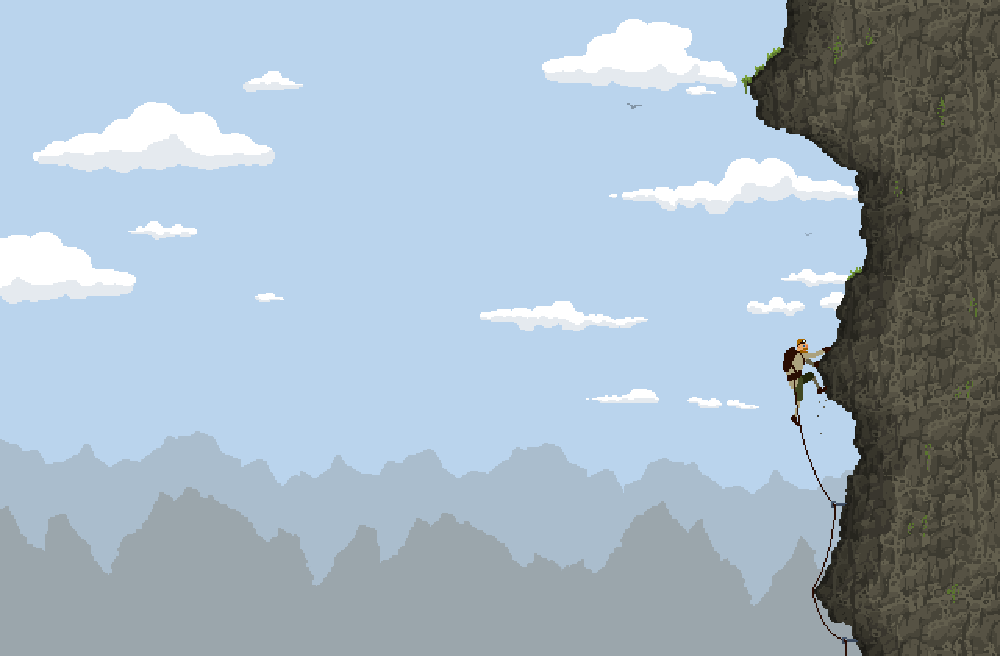

# Nordwand

<p align="center">
  
</p>

<p align="center"><em>A lone climber, a rope, and a wall that never quite looks the same twice.</em></p>

**Nordwand** is a physics-driven climbing prototype. You hang from a generated rock face and try not to let go. The mockup above is the look the game is aiming for: a quiet alpine north wall, pixel clouds, and a climber who is never more than one hold away from empty air.

The current build is the simulation underneath that picture — spring-particle physics, a ragdoll skeleton, a pixel rope, and a two-layer climbing system (decision + motor) that walks the wall hold by hold.

## Play

```bash
npm install
npm run dev
```

Then open [http://localhost:8000](http://localhost:8000). The picture is the concept plate — about 420 pixels tall, the size of `bg_mountains` — scaled up by a whole number so every pixel stays square. On a phone that is a portrait view. Scrolling and pull-to-refresh are disabled. The page itself does not pinch-zoom; two fingers on the picture zoom the climb instead.

The climber already moves by joint angles (see `concept/adr/0001-angular-only-motion.md`). A phone only needs the same two gestures the keyboard has: bow the body, and commit a move on the breath.

| Touch | Action |
| --- | --- |
| **Lean** (bottom left) | Hold and drag. Right bows in toward the rock, left bows out. Same angular offset as **A** / **D**. |
| **Climb** (bottom right) | Commit a move. Time it so the black breath ring sits on the white mark — a tight ring is a perfect move. Tapping the wall does this too. Same as **W**. |
| **Let go** | Release every hold. Same as **F**. |
| **Pinch** the picture | Zoom in or out by whole pixels. A thumb on the lean pad or the buttons is not part of the pinch. |
| Top icons | Pause, new wall, mute, help. |

The lean pad sits at the bottom left and the buttons at the bottom right. Both hide when the window is at least 1100px wide with a mouse, and come back on a narrower window, a tablet, a coarse pointer, or the first touch. Short and landscape screens shrink the pad so it stays on screen. Keyboard play is the same in every layout. The mouse wheel and a pinch zoom by whole logical pixels (1 to 10 world-pixels on a side). The window still picks the integer scale up to the screen.

| Key | Action |
| --- | --- |
| **F** | Let go |
| **R** | New random wall |
| **P** | Pause |
| **H** | Help |
| **M** | Mute |
| **N** | Next song |
| **S** | Freeze physics (zero velocities) |
| **D** | Toggle debug. Holding it also leans in, same as the right arrow. |
| **A** / Left, **Right** | Lean out / lean in |
| **W**, Up | Climb |
| Mouse wheel | Zoom in (up) or out (down), in whole pixels |

## How it feels

Every wall is generated from a noisy walk of segments, then studded with anchors. The face keeps growing above the climber, so the route never ends. The camera eases after the body. The climber is not a sprite with a jump button — they are a chain of particles:

- **Body** — pelvis, back, neck, head
- **Arms and legs** — elbows, wrists, knees, ankles
- **Grabs** — hands and feet pinned to wall anchors
- **Rope** — a Bresenham pixel line from the wall down to the pelvis

Distance springs keep limbs the right length. Angular constraints hold posture. Gravity pulls at 80 units. The climber and rope collide with the rock — they stay on the air side of the wall. If you let go, there is nothing left but the rope and the fall.

The **Climber** walks a fixed three-phase rotation: **LegReach** (the free foot flexes up to a higher anchor, latches), **Push** (the drive leg extends and the body rises while the latched arms adapt their angles), **HandReach** (the lowest hand reaches above the head and latches in extension). Targets come from a hard filter chain — reachability, feet-stay-below-hands, center-of-mass near the wall — never from scoring. Phases end on physical events (a latch, a reached extension), and a stall ladder (re-filter → relaxed reach → substitute move → hold) never forces a grab or releases a planted limb. The full behavior spec lives in `concept/climbing-plan.md`.

## Project

| | |
| --- | --- |
| Language | TypeScript **7.0.2** |
| Bundler | Vite 6 |
| Loop | `requestAnimationFrame` on a 2D canvas |
| Physics | Midpoint spring integration, 4 ms fixed step |

```
src/
  main.ts          entry, canvas setup
  Game.ts          input, pause, level load, frame loop
  Physics.ts       particles, springs, angular constraints
  Wall.ts          procedural face and anchors
  Skeleton.ts      body, limbs, grabs
  Rope.ts          pixel rope
  Climber.ts       decision layer: phases, filter chain, stall ladder
  ClimberMotor.ts  motor layer: move API, IK, angle animation
  Camera.ts        world camera (one world unit = one logical pixel)
  pixelViewport.ts integer scale of that frame onto the screen
  pixelScene.ts    sky, mountain plate, clouds, rock texture
  pixelClimber.ts  pixel figure drawn from the ragdoll
  touchInput.ts    lean pad, same bow as the A/D keys
  MusicPlayer.ts   songs and SFX
  PixelSprite.ts   nearest-neighbor scaled sprites
public/            CSS, control icons, sprites
concept/           visual target for the climb
```

```bash
npm run typecheck   # tsc --noEmit (TypeScript 7)
npm run build       # typecheck + Vite production build
```

## Concept

The image at the top is `concept/nordwand_mockup_04_large.png` — the intended mood of the finished game. Wide sky, layered mountains, a textured wall, and a climber who looks small because the drop is real.

The live view follows that plate. The sky is a flat `#bad4ed`. Distant ridges are `public/sprites/bg_mountains.png`. Clouds are fixed pixel sprites (white, `#e5eaef` underside): small hand-authored puffs plus large and medium banks cut from the mockup, placed from the wall seed, flipped or scaled by a whole number, with the big clouds on a nearer parallax layer. The wall is a cached collage of rock stencils cut from that plate (and a lumpy patch from `tex_fels_01`), dithered into each other from the wall seed. Its silhouette is chosen once per world row from the collision line and baked into those chunks with the lip shading, the ledge moss, and the pitons, so scrolling the camera does not change which world pixel is the edge. The lip darkens from that snapped normal — overhang undersides more than faces turned toward the light — in palette steps. The climber is filled capsules on the ragdoll, in the mockup's own colours and without an outline. The physics skeleton matches that figure: body 15 (neck 11, hip 4), arm reach 14.5, leg reach 14, down from body 24, arm 20, leg 24. Elbows stay at least about 25° from straight and knees at least about 80°, and the hand and foot land on the physics grip. Limbs stretch by at most 15%. The rope still meets the pelvis. The rope is the dark brown `#2a0d03` line, with a metal piton on the same snapped edge. Everything is drawn into the logical frame, then scaled once with nearest-neighbour (`image-rendering: pixelated`, smoothing off). **D** still draws the debug bones and the anchor marks. `?poses=1` draws four still poses of the figure.

Music in the original build: *sevenhundredbeats* by Duncan Beattie.
